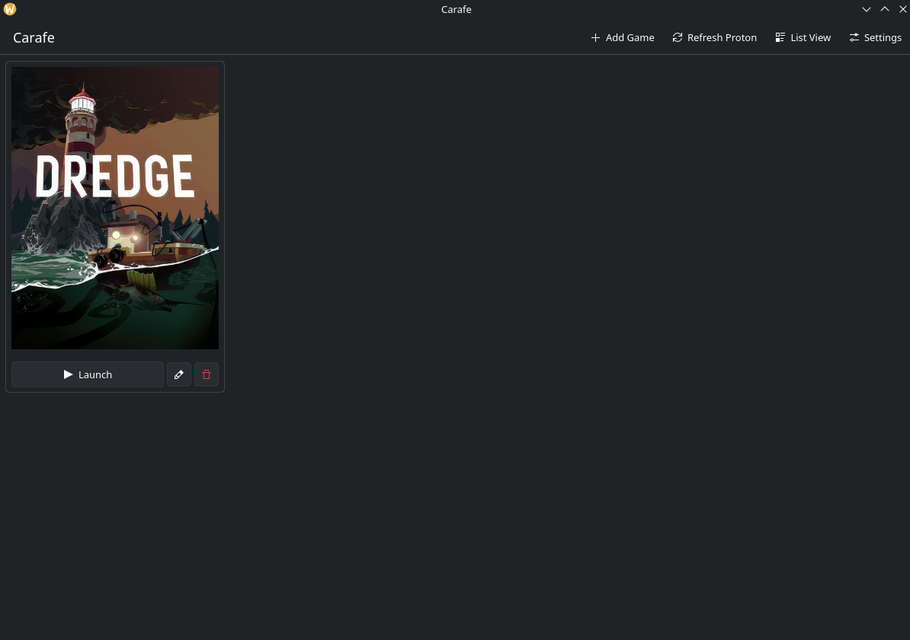
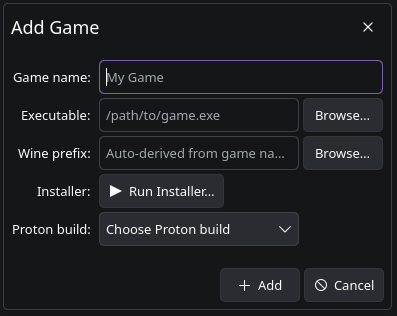

# Carafe

A KDE Plasma-native game launcher for Windows games via Proton/UMU. Built with Qt 6.6+ and Kirigami.

<table>
  <tr>
    <td></td>
    <td></td>
  </tr>
</table>

## Build

### Dependencies

Dependencies: CMake 4.2+, Clang, `openmp` (LLVM OpenMP runtime, required by Kirigami when building with Clang), Qt 6.6+, KF6 (Kirigami, CoreAddons), KDE `union` (for the Union QtQuick style), `umu-launcher`, KF6 Wallet (optional), `icoutils` (optional).

#### Arch Deps

```bash
sudo pacman -S --needed openmp cmake extra-cmake-modules union umu-launcher ninja icoutils just vulkan-headers clang
```

This project supports a `just` workflow for debug/release configuration, building, and installing.

### Debug

```bash
just configure
just build
just run
```

### Release

```bash
just configure release
just build release
sudo just install release
```

### Direct CMake

```bash
cmake -B build -DCMAKE_C_COMPILER=clang -DCMAKE_CXX_COMPILER=clang++
cmake --build build
./build/bin/carafe
```

### Tests

Configure the desired build type, then run the test suite:

```bash
just configure
just test
```

The test recipe builds first. For Release, use `just configure release` and `just test release`. For a direct CMake build:

```bash
cmake -B build -DCMAKE_C_COMPILER=clang -DCMAKE_CXX_COMPILER=clang++
cmake --build build
ctest --test-dir build --output-on-failure
```

## Data

- Library: `~/.local/share/io.marlonn.carafe/library.json`
- Prefixes: `~/carafe/prefixes/<game-slug>/`
